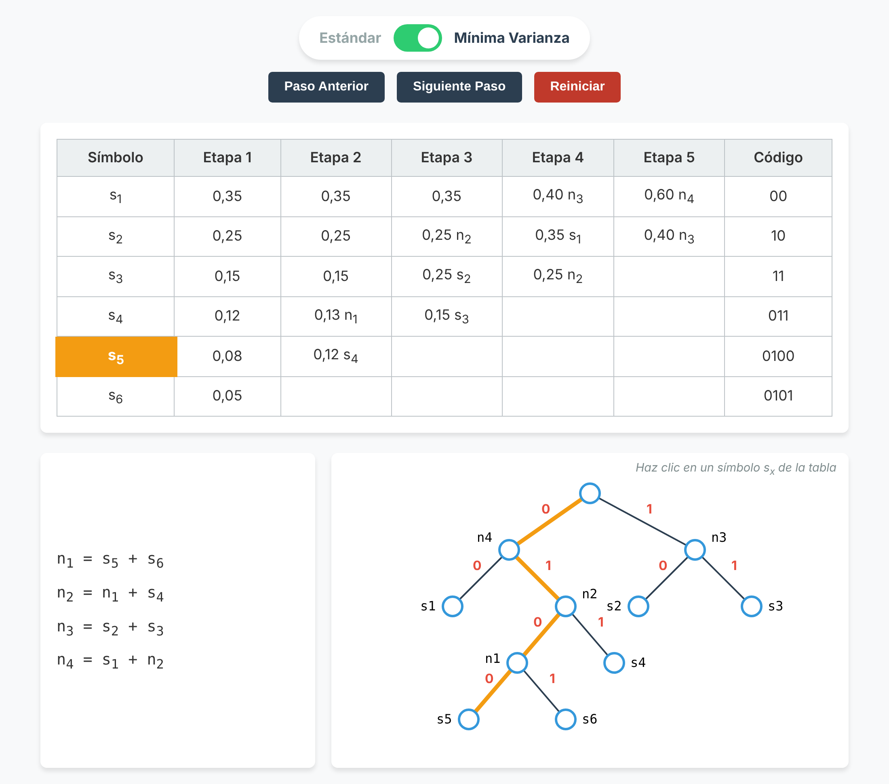

# 🌳 Codificación de Huffman — Visualizador interactivo

Visualizador web que construye **paso a paso** un código de Huffman y permite comparar dos variantes del algoritmo: el método **estándar** y el de **mínima varianza**.

[](https://manueldelahoz.github.io/algoritmo-de-codificacion-de-huffman/)


[](LICENSE)

👉 **Pruébalo aquí:** https://manueldelahoz.github.io/algoritmo-de-codificacion-de-huffman/



---

## ✨ Características

- **Construcción paso a paso.** Cada clic en *Siguiente Paso* fusiona los dos símbolos de menor probabilidad, resalta las celdas que se combinan y muestra la ecuación del nuevo nodo (`n₁ = s₅ + s₆`, …).
- **Dos métodos en una sola vista.** Con el interruptor *Estándar / Mínima Varianza* la tabla, las ecuaciones, el árbol y los códigos cambian al instante.
- **Árbol binario dibujado en SVG,** con las ramas etiquetadas con `0` y `1`.
- **Rutas resaltadas.** Al final, haz clic en cualquier símbolo `sₓ` de la tabla para ver su camino desde la raíz hasta la hoja; esa ruta es su palabra de código.
- **Sin dependencias.** Es un único archivo `index.html` con HTML, CSS y JavaScript puro, sin frameworks ni compilación.

## 🚀 Cómo usarlo

**En línea:** abre la [demo en GitHub Pages](https://manueldelahoz.github.io/algoritmo-de-codificacion-de-huffman/).

**En local:**

```bash
git clone https://github.com/ManuelDeLaHoz/algoritmo-de-codificacion-de-huffman.git
cd algoritmo-de-codificacion-de-huffman
# Abre index.html en tu navegador (doble clic o arrastrándolo a una pestaña)
```

**Controles:**

| Control | Acción |
|---|---|
| **Siguiente Paso** / **Paso Anterior** | Avanza o retrocede una etapa de la construcción |
| **Reiniciar** | Vuelve al estado inicial |
| Interruptor **Estándar / Mínima Varianza** | Cambia el método de desempate |
| Clic en un símbolo `sₓ` (una vez visible el árbol) | Resalta su ruta en el árbol |

## 🧠 Un poco de teoría

La **codificación de Huffman** es un método de compresión sin pérdidas que asigna códigos binarios de **longitud variable**: los símbolos más probables reciben códigos más cortos. El resultado es un **código prefijo** (ninguna palabra es el prefijo de otra), así que se puede decodificar sin ambigüedad. Es una pieza clave de formatos como JPEG, PNG (dentro de DEFLATE) y ZIP.

### Algoritmo

1. Ordenar los símbolos de mayor a menor probabilidad.
2. Combinar los dos de menor probabilidad en un nodo nuevo cuya probabilidad es la suma de ambos.
3. Reubicar el nodo nuevo en la lista ordenada y repetir hasta que quede un solo nodo (la raíz).
4. Recorrer el árbol desde la raíz y asignar `0` y `1` a cada par de ramas. El código de cada símbolo es la secuencia de bits de su camino.

### Estándar vs. mínima varianza

Las dos variantes solo difieren cuando hay un **empate**: el nodo recién creado tiene la misma probabilidad que un símbolo ya existente.

- **Estándar:** el nodo nuevo se ubica **debajo** de los elementos con igual probabilidad.
- **Mínima varianza:** el nodo nuevo se ubica **lo más arriba posible**. Así se fusiona más tarde, el árbol queda más equilibrado y, en general, las longitudes de los códigos varían menos. Esto es útil cuando se transmite a tasa constante y se quiere un búfer más pequeño.

En este ejemplo el empate aparece en la **etapa 3**, donde `n₂ = 0,25` iguala a `s₂ = 0,25`.

## 📊 Ejemplo incluido

Fuente de 6 símbolos:

| Símbolo | Probabilidad | Código (mín. varianza) | Código (estándar) | Longitud |
|:---:|:---:|:---:|:---:|:---:|
| s₁ | 0,35 | `00`   | `00`   | 2 |
| s₂ | 0,25 | `10`   | `01`   | 2 |
| s₃ | 0,15 | `11`   | `11`   | 2 |
| s₄ | 0,12 | `011`  | `101`  | 3 |
| s₅ | 0,08 | `0100` | `1000` | 4 |
| s₆ | 0,05 | `0101` | `1001` | 4 |

Construcción de nodos:

| Nodo | Mínima varianza | Estándar |
|---|---|---|
| n₁ = 0,13 | s₅ + s₆ | s₅ + s₆ |
| n₂ = 0,25 | n₁ + s₄ | n₁ + s₄ |
| n₃ = 0,40 | **s₂ + s₃** | **n₂ + s₃** |
| n₄ = 0,60 | **s₁ + n₂** | **s₁ + s₂** |

### Métricas

| Métrica | Fórmula | Valor |
|---|---|---|
| Entropía | H = −Σ pᵢ log₂ pᵢ | ≈ 2,315 bits/símbolo |
| Longitud media | L̄ = Σ pᵢ ℓᵢ | 2,38 bits/símbolo |
| Eficiencia | η = H / L̄ | ≈ 97,3 % |
| Varianza de la longitud | σ² = Σ pᵢ (ℓᵢ − L̄)² | ≈ 0,496 bits² |
| Razón de compresión vs. código fijo de 3 bits | 3 / L̄ | ≈ 1,26 |

> **📝 Nota:** con esta distribución en particular, los dos métodos generan **árboles distintos pero las mismas longitudes de código** (2, 2, 2, 3, 4, 4). Por eso la longitud media y la varianza coinciden. El ejemplo sirve para ver *cómo* cambia la construcción del árbol según la regla de desempate; para ver una reducción real de la varianza hace falta una distribución donde el desempate cambie la profundidad de las hojas (por ejemplo, p = 0,4 / 0,2 / 0,2 / 0,1 / 0,1, donde la varianza baja de 1,36 a 0,16).

## 📁 Estructura

```
.
├── index.html      # Visualizador completo (HTML + CSS + JS)
├── LICENSE         # Licencia MIT
├── assets/
│   └── demo.png    # Captura usada en este README
└── README.md
```

## 🛠️ Tecnologías

- **HTML5** para la estructura y la tabla de etapas.
- **CSS3** para el diseño, las transiciones y el interruptor.
- **SVG** para dibujar los árboles.
- **JavaScript (vanilla)** para controlar los pasos, cambiar de método y resaltar las rutas.

## 👤 Autor

**Manuel De La Hoz** — [@ManuelDeLaHoz](https://github.com/ManuelDeLaHoz)

## 📄 Licencia

Este proyecto está bajo la licencia [MIT](LICENSE): puedes usarlo, modificarlo y distribuirlo libremente, siempre que mantengas el aviso de copyright.
